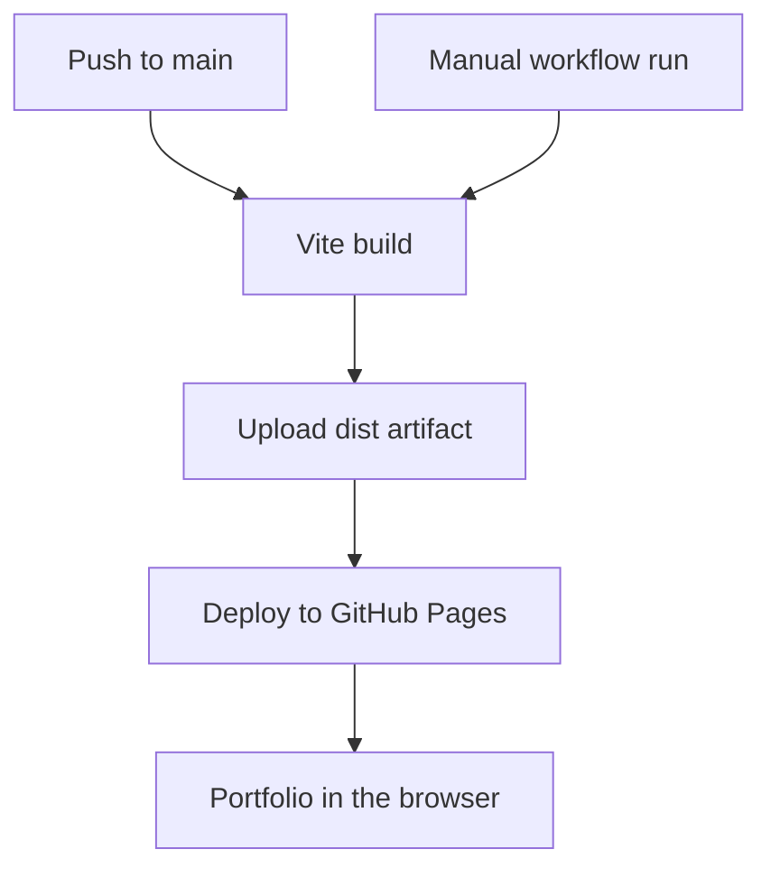

# Mustafa “Moose” McLinn

**Systems Engineer · Oakland, California**

[View my portfolio](https://parkingpet.github.io/) · [Try the DevOps toolkit](https://parkingpet.github.io/#tools) · [Connect on LinkedIn](https://www.linkedin.com/in/mustafa-mclinn-a55a9a9)

I’m an independent technology consultant with more than 19 years of experience in systems administration and technical support. I started out building a computer graphics department. Since then, I’ve helped artists troubleshoot rendering workstations, kept dental practices connected to their imaging systems, and built a remote studio for community radio.

## Selected work

**RE:Vision Effects · Visual effects infrastructure**  
I supported artists in Japan, India, and Russia using visual effects software on Windows, macOS, and Linux. My work ranged from diagnosing installation and network issues to rolling out production updates on AWS.

**Poor Magazine · Community broadcasting**  
I built a remote radio studio and set up streaming so contributors could get their programs on air. The work brought together audio routing, networking, and an interest I still pursue as a licensed amateur radio operator.

**LANgineers · Business telephony**  
I worked on the SIP softswitch serving more than 40 clients, connecting my networking background with the day-to-day demands of business phone service.

[Browse projects](https://parkingpet.github.io/#projects) · [Explore my work history](https://parkingpet.github.io/#experience)

## Technical focus

| Practice | Tools and platforms |
| :--- | :--- |
| Identity and endpoint management | Microsoft Entra ID, Active Directory, Okta, Intune, Jamf |
| Cloud and infrastructure | AWS, Azure, Google Cloud, VMware, Docker |
| Automation and delivery | PowerShell, Bash, Python, Ansible, GitHub Actions |
| Networking and voice | DNS, DHCP, VLANs, VPNs, SIP |

## About this repository

This React portfolio includes a [browser toolkit](https://parkingpet.github.io/#tools) for tasks such as formatting JSON and calculating subnets. The [page layout](src/App.jsx) connects the résumé, projects, toolkit, and [MCP resources](https://parkingpet.github.io/#mcp-servers).

<details>
<summary><strong>Site architecture and local development</strong></summary>

## From source to site


The [deployment workflow](.github/workflows/deploy.yml) builds the React application with Vite. GitHub Pages serves the resulting static files to visitors.





<details>
<summary>Architecture map source for Archify</summary>


```json
{
  "schema_version": 1,
  "diagram_type": "architecture",
  "meta": {"title": "ParkingPet portfolio", "output": "portfolio.html"},
  "components": [
    {"id":"repo","type":"external","label":"Repository","sublabel":"React source","pos":[40,100],"size":[150,64]},
    {"id":"build","type":"backend","label":"GitHub Actions","sublabel":"Vite build","pos":[260,100],"size":[150,64]},
    {"id":"pages","type":"cloud","label":"GitHub Pages","sublabel":"Static hosting","pos":[480,100],"size":[150,64]},
    {"id":"visitor","type":"external","label":"Visitor","sublabel":"Browser","pos":[700,100],"size":[150,64]}
  ],
  "connections": [
    {"id":"checkout","from":"repo","to":"build"},
    {"id":"publish","from":"build","to":"pages","label":"dist"},
    {"id":"serve","from":"pages","to":"visitor","label":"HTTPS"}
  ]
}
```


</details>


## Run locally


Use Node.js 24 or newer and pnpm 10.23.0.


```sh
git clone https://github.com/Parkingpet/parkingpet.github.io.git
cd parkingpet.github.io
pnpm install
pnpm dev
```


Open the URL printed by Vite. To check a production build locally, run `pnpm build` followed by `pnpm preview`.


[Page layout](src/App.jsx) · [Components](src/components) · [Deployment history](https://github.com/Parkingpet/parkingpet.github.io/actions/workflows/deploy.yml) · [License](LICENSE)

</details>
