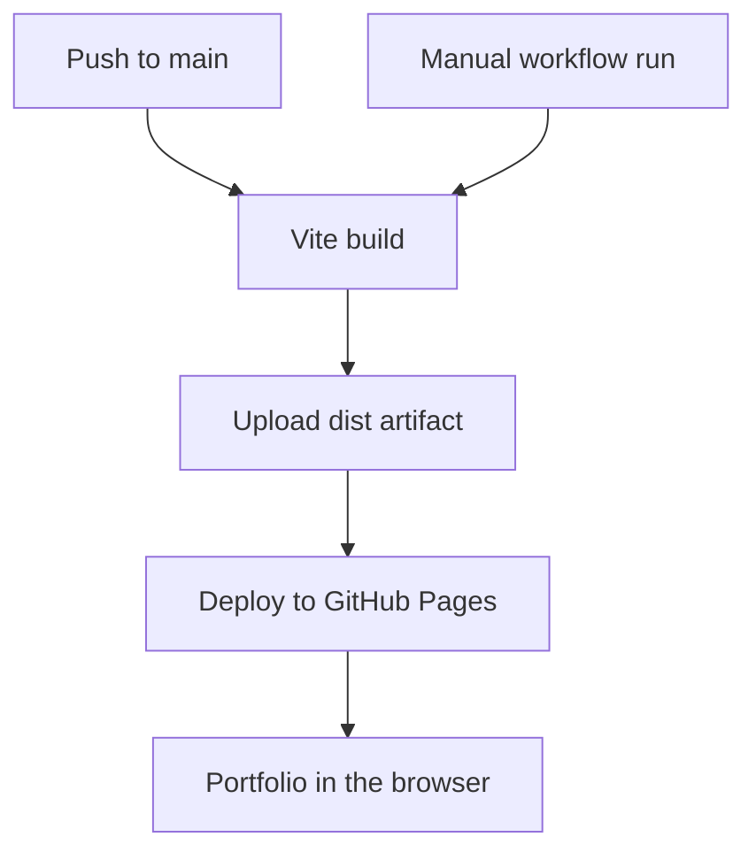

<h1 align="center">Mustafa “Moose” McLinn</h1>
<p align="center"><strong>Systems engineering · Cloud infrastructure · DevOps</strong><br>Oakland, California</p>

```text
    |\  /|    ___    ___    ___   ____
    | \/ |   /   \  /   \  / __| | ___|
    | |  |  | (_) || (_) | \__ \ | _|
    |_|  |_|  \___/  \___/  |___/ |____|
```

**[Explore the live portfolio ↗](https://parkingpet.github.io/)** · [Open the toolkit](https://parkingpet.github.io/#tools) · [LinkedIn](https://www.linkedin.com/in/mustafa-mclinn-a55a9a9)

I’ve rolled out AWS production updates for a visual effects developer, supported dental imaging systems, and connected a remote studio to a community radio station. This portfolio brings those projects together with the tools I use to troubleshoot infrastructure.

## Find your way around

| Explore | Start here |
| :--- | :--- |
| Engineering work | [Projects](https://parkingpet.github.io/#projects) · [Technical skills](https://parkingpet.github.io/#skills) |
| Professional background | [Experience](https://parkingpet.github.io/#experience) · [Clients](https://parkingpet.github.io/#clients) · [Education](https://parkingpet.github.io/#education) |
| Developer resources | [DevOps tools](https://parkingpet.github.io/#tools) · [MCP servers](https://parkingpet.github.io/#mcp-servers) |

## From source to site

The [deployment workflow](.github/workflows/deploy.yml) builds the React application with Vite. GitHub Pages serves the resulting static files to visitors.



<details>
<summary>Architecture map source for Archify</summary>

```json
{
  "schema_version": 1,
  "diagram_type": "architecture",
  "meta": {"title": "ParkingPet portfolio", "output": "portfolio.html"},
  "components": [
    {"id":"repo","type":"external","label":"Repository","sublabel":"React source","pos":[40,100],"size":[150,64]},
    {"id":"build","type":"backend","label":"GitHub Actions","sublabel":"Vite build","pos":[260,100],"size":[150,64]},
    {"id":"pages","type":"cloud","label":"GitHub Pages","sublabel":"Static hosting","pos":[480,100],"size":[150,64]},
    {"id":"visitor","type":"external","label":"Visitor","sublabel":"Browser","pos":[700,100],"size":[150,64]}
  ],
  "connections": [
    {"id":"checkout","from":"repo","to":"build"},
    {"id":"publish","from":"build","to":"pages","label":"dist"},
    {"id":"serve","from":"pages","to":"visitor","label":"HTTPS"}
  ]
}
```

</details>

## Run locally

Use Node.js 24 or newer and pnpm 10.23.0.

```sh
git clone https://github.com/Parkingpet/parkingpet.github.io.git
cd parkingpet.github.io
pnpm install
pnpm dev
```

Open the URL printed by Vite. To check a production build locally, run `pnpm build` followed by `pnpm preview`.

[Page layout](src/App.jsx) · [Components](src/components) · [Deployment history](https://github.com/Parkingpet/parkingpet.github.io/actions/workflows/deploy.yml) · [License](LICENSE)
