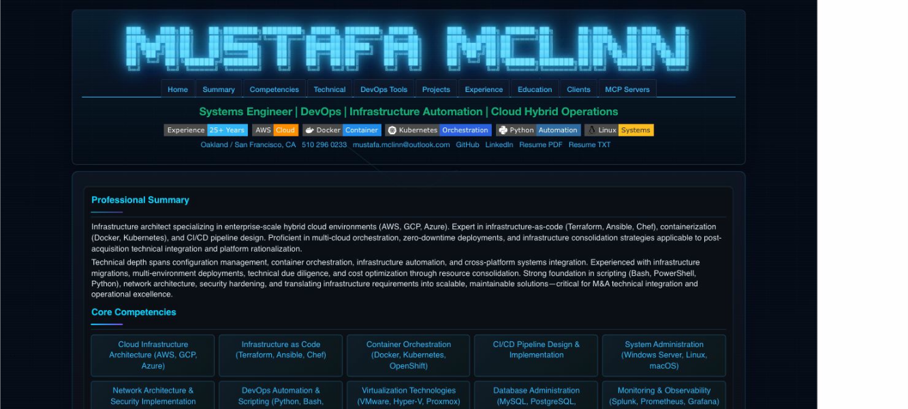
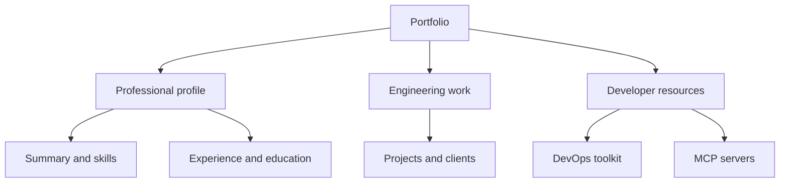
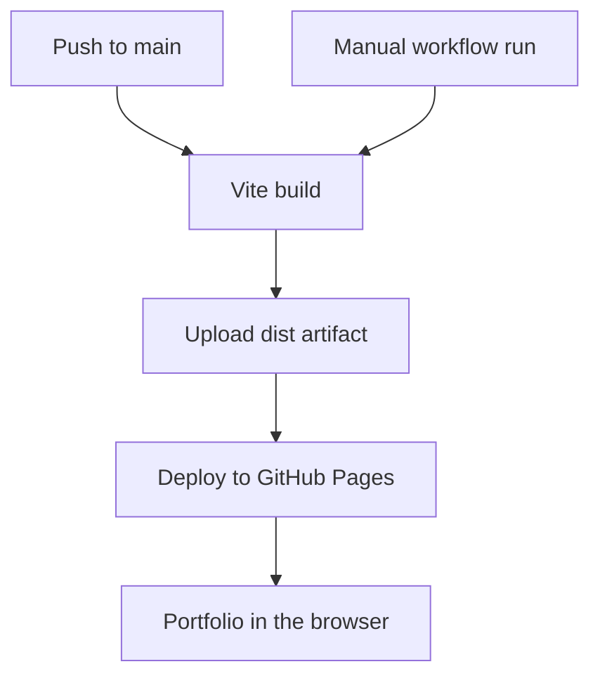

# Mustafa “Moose” McLinn

**Systems Engineer · Oakland, California**

[View my portfolio](https://parkingpet.github.io/) · [Try the DevOps toolkit](https://parkingpet.github.io/#tools) · [Connect on LinkedIn](https://www.linkedin.com/in/mustafa-mclinn-a55a9a9)

I’m an independent technology consultant with more than 19 years of experience in systems administration and technical support. I started out building a computer graphics department. Since then, I’ve helped artists troubleshoot rendering workstations, kept dental practices connected to their imaging systems, and built a remote studio for community radio.


    

[](https://parkingpet.github.io/)

## Portfolio map

| Section | Live page | React component |
| :--- | :--- | :--- |
| [Summary](#overview) | [Open section](https://parkingpet.github.io/#summary) | [Summary](src/components/summary/Summary.jsx) |
| [Skills](#technical-skills) | [Open section](https://parkingpet.github.io/#skills) | [Skills](src/components/skills/Skills.jsx) |
| [Projects](#projects) | [Open section](https://parkingpet.github.io/#projects) | [Projects](src/components/projects/Projects.jsx) |
| [Experience](#professional-experience) | [Open section](https://parkingpet.github.io/#experience) | [Experience](src/components/experience/Experience.jsx) |
| [Education](#education) | [Open section](https://parkingpet.github.io/#education) | [Education](src/components/education/Education.jsx) |
| [Clients](#client-directory) | [Open section](https://parkingpet.github.io/#clients) | [Clients](src/components/clients/Clients.jsx) |
| [Tools](#devops-toolkit) | [Open section](https://parkingpet.github.io/#tools) | [Tools](src/components/tools/Tools.jsx) |
| [MCP servers](#mcp-server-directory) | [Open section](https://parkingpet.github.io/#mcp-servers) | [MCPServers](src/components/mcp/MCPServers.jsx) |



## Overview

Infrastructure architect specializing in enterprise-scale hybrid cloud environments (AWS, GCP, Azure). Expert in infrastructure-as-code (Terraform, Ansible, Chef), containerization (Docker, Kubernetes), and CI/CD pipeline design. Proficient in multi-cloud orchestration, zero-downtime deployments, and infrastructure consolidation strategies applicable to post-acquisition technical integration and platform rationalization.

Technical depth spans configuration management, container orchestration, infrastructure automation, and cross-platform systems integration. Experienced with infrastructure migrations, multi-environment deployments, technical due diligence, and cost optimization through resource consolidation. Strong foundation in scripting (Bash, PowerShell, Python), network architecture, security hardening, and translating infrastructure requirements into scalable, maintainable solutions—critical for M&A technical integration and operational excellence.

<details>
<summary>Core competencies</summary>

- Cloud Infrastructure Architecture (AWS, GCP, Azure)
- Infrastructure as Code (Terraform, Ansible, Chef)
- Container Orchestration (Docker, Kubernetes, OpenShift)
- CI/CD Pipeline Design & Implementation
- System Administration (Windows Server, Linux, macOS)
- Network Architecture & Security Implementation
- DevOps Automation & Scripting (Python, Bash, PowerShell)
- Virtualization Technologies (VMware, Hyper-V, Proxmox)
- Database Administration (MySQL, PostgreSQL, MSSQL, NoSQL)
- Monitoring & Observability (Splunk, Prometheus, Grafana)
- Security & Compliance (IAM, 2FA, Network Security)
- Enterprise IT Consulting & Solution Architecture
- Hybrid Cloud Migration & Integration Strategies
- Zero-Downtime Deployment & Blue-Green Strategies
- Configuration Management & Automation
- Incident Response & Performance Optimization
- Multi-Environment Infrastructure Management
- API Integration & Microservices Architecture
- Backup & Disaster Recovery Planning
- Cost Optimization & Resource Consolidation

</details>

## Technical skills

| Area | Technologies |
| :--- | :--- |
| Operating Systems | Windows 10 11, Windows Server, macOS, Linux CentOS Ubuntu CoreOS |
| Scripting and Programming | Bash, PowerShell, Python, Ruby, Node.js |
| Cloud | AWS EC2 S3 IAM, GCP, Azure |
| DevOps and Automation | Ansible, Jenkins, Terraform, Chef, GitLab CI |
| Networking | LAN WAN, VPN, Firewalls, VLANs, Cisco, HP |
| Security | IAM, 2FA, network security protocols, access controls |
| Databases | MySQL, PostgreSQL, MSSQL, NoSQL |
| Tools | Jira, GitHub, Artifactory, Splunk, SCCM, XenApp |

## Projects

### [ParkingPet](https://github.com/Parkingpet)

Smart parking platform concept and public project site.

- Current GitHub Pages repo used for public facing presence and iteration: Parkingpet/parkingpet.github.io
- Foundation oriented build intended to evolve into a platform with strong emphasis on reliability, automation, and clean deploy patterns
- React-based resume site with terminal UI, DevOps tools integration, and automated CI/CD deployment
- Features animated grid backgrounds, CRT effects, and integrated Base64, JSON, Hash, Regex, and Timestamp tools

### [RevisionFX.tech](https://github.com/endorfinized)

Technical support and development resources.

- GitHub repository for RevisionFX technical resources and support tools
- Development work supporting video plugin infrastructure and customer solutions

### [Teckguy](https://github.com/teckguy)

Technical consulting and IT support GitHub profile.

- GitHub profile for Teckguy consulting services and technical projects
- Repository collection for IT infrastructure and automation work

### [Pleynice](https://github.com/pleynice)

Personal GitHub profile and project portfolio.

- Personal GitHub account showcasing various technical projects and contributions
- Repository collection demonstrating coding skills and project work

## Professional experience

### Teckguy

**Independent Consultant | System Administration and IT Support** · 1995 to Present

- Provided IT consulting and technical support across healthcare, insurance, legal, arts, nonprofit, and MSP environments with critical analysis and resource-based methodologies
- Configured and managed HaloPSA and RMM workflows for Flo.Solutions MSP operations, including Microsoft 365 administration via Admin Center, Teams, Graph API, and automation
- Built and supported ticketing, streaming, NAS, and web solutions for remote and onsite use cases including cPanel and WordPress implementations
- Managed mixed environment infrastructure for Windows, macOS, and Linux including printers, specialized devices, switches, routers, and hybrid backup strategies with failover
- Implemented PowerShell and Bash automation scripts for endpoint management, user provisioning, and system monitoring across heterogeneous environments
- Configured and maintained Active Directory, Group Policy, DNS, DHCP, and certificate services for enterprise authentication and network infrastructure
- Deployed and managed virtualization platforms including VMware ESXi, Hyper-V, and Proxmox for development and production workloads
- Supported personal projects requiring CI/CD, Git repos, and LLM implementations on multiple stacks
- Demonstrated commitment to ethical practices through observation and understanding of unique diverse empirical concepts

### Flo.Solutions

**MSP Consultant | HaloPSA Configuration & Automation | Tech Support Tier I-II** · 2024

- Configured and connected HaloPSA/Remote Management software and automation for small MSP operations
- Implemented RMM workflows and automation strategies to streamline MSP service delivery
- Integrated Microsoft Graph API for automated user provisioning, license management, and tenant administration
- Configured PowerShell scripts for automated ticket creation, asset management, and client reporting workflows
- Provided technical consulting for managed service provider infrastructure optimization

### RevisionFX

**Systems Administrator | Tier I II Support** · Feb 2004 to Feb 2024

- Delivered 24/7 support for global customers across Japan, Russia, India, and other regions supporting 40+ plugins across 15+ applications on Windows, macOS, and Linux
- Maintained cloud infrastructure and rolled updates to AWS production environments with zero downtime using blue-green deployment strategies
- Managed EC2 instances, S3 buckets, CloudFront distributions, and Route 53 DNS configurations for production workloads
- Supported Microsoft 365 for internal staff and assisted with endpoint and account troubleshooting
- Diagnosed complex hardware issues including CUDA GPU conflicts, network card problems, and low-level configuration resource conflicts
- Built automation scripts and environment fixes using PowerShell, Bash, and shell tooling to resolve licensing, network, and OS specific issues
- Developed Python scripts for log analysis, automated testing, and customer data migration tasks
- Mocked up AI/chat support automation to replace Tier I involvement and improve efficiency
- Provided onsite hardware break-fix for complex issues and occasional remote services backup for production environments

### Insight Engines

**DevOps | Knowledge Engineer** · Jan 2019 to Apr 2019

- Rebuilt CoreOS-driven Docker containers using Ansible on Google Cloud Platform
- Used GitLab CI/CD tools and Jira to manage workflows and deployments
- Implemented Ansible playbooks for automated container orchestration, configuration management, and application deployment
- Configured Docker Compose and Kubernetes manifests for microservices architecture on GCP
- Audited GCP infrastructure and optimized cloud resource management and reliability
- Removed build artifacts from development architectures to reduce cloud costs and improve performance
- Performed onboarding procedures and personal environment setup for infrastructure automation

### Splunk

**Systems Engineer** · Mar 2018 to May 2018

- Maintained Splunk Cloud services in high-intensity production environment with 24/7 support across multiple time zones
- Worked in intense environment with twelve-hour shifts and weekend rotations to maintain cloud service availability
- Resolved complex Splunk issues, performed instance rebuilds, and optimized AWS EC2 stacks for performance and cost
- Configured Splunk forwarders, indexers, and search heads for distributed log aggregation and analysis
- Developed and refined automation scripts in Bash, Ruby, and Node.js to improve operational workflows
- Implemented monitoring and alerting using Splunk queries, dashboards, and scheduled searches for proactive incident response
- Used Jira, Jenkins, GitHub, Artifactory, and various 2FA tools for infrastructure management
- Supported Ubuntu-based infrastructure with limited resources on AWS EC2 stacks

### Workday

**Systems Engineer** · May 2016 to Aug 2017

- Managed Chef server nodes and supported CentOS upgrades with documented best practices and methodology tracking
- Executed 4,500+ CentOS live upgrades across global production environments, silos, and Chef nodes with zero downtime
- Developed Chef cookbooks and recipes for automated configuration management and compliance enforcement
- Completed upgrade efforts ahead of schedule through coordinated environment and role owner collaboration
- Developed and improved Bash, Ruby, and Python scripts supporting automation and operations
- Created instructional video documentation to enable self-service upgrades and reduced support load
- Supported team effort resolving DirtyCow security vulnerability across all global datacenters
- Implemented Knife commands and Chef workflows for node bootstrapping, cookbook deployment, and environment management
- Supported servers running Zookeeper, Kafka, Jira, Bitbucket, Docker, and other critical infrastructure
- Used Gerrit for collaborative development and Jenkins for testing and deployment

### John Muir Health

**LAN Engineer** · Mar 2015 to Mar 2016

- Supported hybrid enterprise infrastructure in healthcare environment focused on patient safety, uptime, and operational efficiency
- Maintained LAN and NOC performance and security safeguards with 24/7 availability and little to no supervision
- Coordinated with LAN team to plan and implement future state network architecture for healthcare organization
- Configured Cisco switches, routers, and wireless controllers for VLAN segmentation and network security
- Provided Level III technical and escalation support for Office 365, Exchange, Active Directory, and Epic configuration
- Managed network provisions, performance tuning, port assignment, error tracking, and data movement
- Automated onboarding and provisioning using PowerShell and Azure tooling for incoming students and staff
- Implemented network monitoring using SNMP, NetFlow, and packet capture tools for troubleshooting and capacity planning
- Supported systems integration and core enterprise network operational efficiency and security safeguards

### First Republic Bank

**Desktop Engineering | Tier III Support** · Mar 2011 to Apr 2011

- Provided Tier III troubleshooting and systems upgrades for enterprise banking environment
- Configured SCCM and Active Directory to streamline deployments and workstation management
- Built batch scripts to automate repeatable troubleshooting and remediation tasks

### Concord Feed and Fuel

**MIS and Systems Administration** · Mar 2007 to Apr 2011

- Sole IT owner for multi-location retail and administrative infrastructure across multiple sites
- Deployed and maintained Citrix XenApp, VPN, and RedHat-based POS systems for retail operations
- Automated operations using Bash, PowerShell, and batch scripting across endpoints and servers
- Managed infrastructure with little to no supervision in complex retail environment

### Additional Roles

**Infrastructure and Support** · 2000 to 2006

- UCSF California Poison Control: Maintained WAN/LAN infrastructure and implemented security enhancements and digital phone systems
- SnoCap DRM: Supported infrastructure, Cisco systems, and SIP configurations for company formerly known as Napster
- Ticket Planet: Managed Windows 2000 Server, Exchange, and Cisco networks for fourth largest online travel agency in US
- Dimension 7: Built and maintained render farms and networked CG workstations for film production environments

## Client directory

| Client | Period | Engagement |
| :--- | :--- | :--- |
| RevisionFX | 2004-2024 | Desktop/Hardware support, production and testing environments, developer-adjacent troubleshooting |
| Poor Magazine | 2019-2020 | Radio station build, remote studio setup, NAS implementation, web services, Mac/PC support, streaming services |
| Dr. Rathod Dental Office | 2019-2025 | X-ray systems, Dentrix support, backups, printers, Server 2022 administration |
| Flo.Solutions | 2024-2025 | HaloPSA API configuration, Microsoft 365 automation via Graph API for MSP operations |
| Eastside Arts Alliance | 2019 | Endpoint support, printer setups, Office instruction, email configuration |
| LANgineers | 2014 | Arc SoftSwitch SIP phone deployment for 40+ clients supporting 400+ VoIP phones |
| Dr. Cox Dental Office | 1999-2019 | 22-year partnership providing Dentrix database support and digital X-ray systems |
| David Quan Insurance | 2012-2014 | Infrastructure and Microsoft Office and email support |
| LMI | 2012 | Broad small business tech support |
| Charles Bonner Law | 2004-2005 | Litigation support and technical assistance during litigation and arbitrations |
| Osha Neumann | 1999-2023 | Long-term personal support and voice-to-text tooling configuration for two decades |
| Lumibuild | 2025 | Wired 6 building IDF/MDF, installed racks/keystone jacks and Cat6a for Meter network appliances |

## Education

- Golden Gate University: Management, 2012 to 2014
- Lincoln University: Computer Science, 2003 to 2005
- Diablo Valley College: Computer Science, 1999
- Academy of Art University: 3D Modeling, 1998
- Southern University: Electrical Engineering, 1993 to 1994

## DevOps toolkit

[Open the interactive toolkit](https://parkingpet.github.io/#tools)

| Tool | Available actions or reference |
| :--- | :--- |
| Base64 | Encode · Decode |
| JSON | Format · Minify |
| Timestamp | ToDate · ToUnix · Now |
| UUID | Generate |
| URL | Encode · Decode |
| SHA-256 | Hash |
| Regex | Test · Match |
| JWT Decoder | Decode |
| YAML to JSON | Convert |
| MAC Formatter | Colon · Hyphen · Dot · Continuous |
| IP Converter | Binary · Hex · Decimal |
| CLI Commands | Docker · Kubectl · Git · Terraform · Aws |
| Infrastructure | Ports · Cidr · Dns · Ssl |
| Subnet Calc | Calculate |
| DevOps Tools | Cicd · Monitoring · Containers · Orchestration |
| MS Admin | Adcommands · Powershell · Exchange · Sharepoint |
| Sed/Awk | FindReplace · DeleteLines · ExtractFields · CountLines · PrintLines · Transform |

<details>
<summary>Tools, cloud consoles and product links</summary>

- [View Live Site](https://parkingpet.github.io/) · Interactive DevOps resume with built-in tools
- [GitHub Repository](https://github.com/Parkingpet/parkingpet.github.io) · Source code and documentation
- [Fork This Project](https://github.com/Parkingpet/parkingpet.github.io/fork) · Create your own version - Fork at your own risk
- [Docker](https://www.docker.com/) · Container platform and registry
- [Kubernetes](https://kubernetes.io/) · Container orchestration platform
- [Terraform](https://www.terraform.io/) · Infrastructure as Code tool
- [Ansible](https://www.ansible.com/) · Configuration management automation
- [Jenkins](https://www.jenkins.io/) · CI/CD automation server
- [Prometheus](https://prometheus.io/) · Monitoring and alerting system
- [Grafana](https://grafana.com/) · Visualization and analytics platform
- [Elastic Stack](https://www.elastic.co/) · Search and analytics engine
- [PostgreSQL](https://www.postgresql.org/) · Advanced open source database
- [MongoDB](https://www.mongodb.com/) · NoSQL document database
- [NGINX](https://www.nginx.com/) · Web server and reverse proxy
- [Linux](https://www.linux.org/) · Open source operating system
- [Git](https://git-scm.com/) · Distributed version control system
- [GitLab](https://www.gitlab.com/) · DevOps platform with CI/CD
- [Jira](https://www.atlassian.com/software/jira) · Issue tracking and project management
- [Bitbucket](https://www.atlassian.com/software/bitbucket) · Git repository management
- [Consul](https://www.hashicorp.com/products/consul) · Service mesh and service discovery
- [Vault](https://www.hashicorp.com/products/vault) · Secrets management and encryption
- [Splunk](https://www.splunk.com/) · Log analysis and monitoring
- [Datadog](https://www.datadoghq.com/) · Cloud monitoring and analytics
- [New Relic](https://www.newrelic.com/) · Application performance monitoring
- [Chef](https://www.chef.io/) · Infrastructure automation platform
- [Puppet](https://www.puppet.com/) · Infrastructure as Code automation
- [Vagrant](https://www.vagrantup.com/) · Development environment automation
- [Packer](https://www.packer.io/) · Machine image builder
- [OpenStack](https://www.openstack.org/) · Open source cloud computing
- [VMware](https://www.vmware.com/) · Virtualization and cloud platform
- [Red Hat](https://www.redhat.com/) · Enterprise Linux and solutions
- [Ubuntu](https://www.ubuntu.com/) · Debian-based Linux distribution
- [CentOS](https://www.centos.org/) · Community-driven Linux distribution
- [Apache](https://www.apache.org/) · Web server and software foundation
- [MySQL](https://www.mysql.com/) · Relational database management
- [Redis](https://redis.io/) · In-memory data structure store
- [RabbitMQ](https://www.rabbitmq.com/) · Message broker and queue system
- [Apache Kafka](https://kafka.apache.org/) · Distributed event streaming platform
- [NGINX Plus](https://www.nginx.com/products/nginx/) · Advanced load balancing and proxy
- [HAProxy](https://www.haproxy.org/) · Load balancer and proxy server
- [Docker Hub](https://www.docker.com/products/docker-hub) · Container image registry
- [Helm](https://helm.sh/) · Kubernetes package manager
- [ArgoCD](https://www.argocd.io/) · GitOps continuous deployment
- [Flux](https://www.fluxcd.io/) · GitOps toolkit for Kubernetes
- [Istio](https://www.istio.io/) · Service mesh for Kubernetes
- [Linkerd](https://linkerd.io/) · Lightweight service mesh
- [Envoy](https://www.envoyproxy.io/) · Edge and service proxy
- [Terraform Cloud](https://www.terraform.io/cloud) · Managed Terraform service
- [Pulumi](https://www.pulumi.com/) · Infrastructure as Code SDK
- [CloudFormation](https://www.cloudformation.io/) · AWS infrastructure templates
- [SonarQube](https://www.sonarqube.org/) · Code quality and security analysis
- [Snyk](https://www.snyk.io/) · Developer security platform
- [Nomad](https://www.hashicorp.com/products/nomad) · Workload orchestration platform
- [Docker Swarm](https://www.docker.com/products/docker-swarm) · Native Docker orchestration
- [Cilium (eBPF)](https://cilium.io/) · eBPF-based Networking & Security
- [WasmEdge](https://wasmedge.org/) · Lightweight WebAssembly runtime
- [Backstage](https://backstage.io/) · Open platform for building developer portals
- [LangChain](https://python.langchain.com/) · Building applications with LLMs
- [AWS Console](https://console.aws.amazon.com/) · EC2, S3, Lambda, RDS
- [AWS IAM](https://console.aws.amazon.com/iam) · Identity & Access Management
- [AWS CloudWatch](https://console.aws.amazon.com/cloudwatch) · Monitoring & Logs
- [AWS CodePipeline](https://console.aws.amazon.com/codesuite/codepipeline) · CI/CD Pipeline
- [GCP Console](https://console.cloud.google.com/) · Compute, Storage, BigQuery
- [GCP Cloud Run](https://console.cloud.google.com/run) · Serverless containers
- [Azure Portal](https://portal.azure.com/) · VMs, App Service, SQL
- [Azure DevOps](https://dev.azure.com/) · Pipelines & Repos
- [Microsoft Intune](https://intune.microsoft.com/) · Device and app management
- [Microsoft Entra](https://entra.microsoft.com/) · Identity and access management
- [Microsoft 365 Admin](https://admin.microsoft.com/) · Organization administration
- [Azure Documentation](https://learn.microsoft.com/en-us/azure/) · Learning resources and guides
- [AWS Management Console](https://console.aws.amazon.com/) · Cloud infrastructure and services
- [EC2 Instances](https://console.aws.amazon.com/ec2) · Virtual compute resources
- [S3 Storage](https://console.aws.amazon.com/s3) · Object storage service
- [AWS Documentation](https://docs.aws.amazon.com/) · Learning resources and guides
- [GCP Console](https://console.cloud.google.com/) · Cloud infrastructure and services
- [Compute Engine](https://console.cloud.google.com/compute) · Virtual machine instances
- [Cloud Storage](https://console.cloud.google.com/storage) · Object storage service
- [GCP Documentation](https://cloud.google.com/docs) · Learning resources and guides

</details>

<details>
<summary>CLI installation commands listed on the site</summary>

| Tool | Command |
| :--- | :--- |
| OpenAI CLI | `curl https://openai.com/install \| bash` |
| Ollama | `curl -fsSL https://ollama.ai/install.sh \| sh` |
| Vercel CLI | `npm i -g vercel` |
| Netlify CLI | `npm install -g netlify-cli` |
| Docker | `curl -fsSL https://get.docker.com -o get-docker.sh && sh get-docker.sh` |
| kubectl | `curl -LO "https://dl.k8s.io/release/$(curl -L -s https://dl.k8s.io/release/stable.txt)/bin/linux/amd64/kubectl"` |
| Terraform | `curl -fsSL https://apt.releases.hashicorp.com/gpg \| sudo apt-key add - && sudo apt-add-repository "deb [arch=amd64] https://apt.releases.hashicorp.com $(lsb_release -cs) main" && sudo apt-get update && sudo apt-get install terraform` |
| AWS CLI | `curl "https://awscli.amazonaws.com/awscli-exe-linux-x86_64.zip" -o "awscliv2.zip"` |
| Google Cloud CLI | `curl https://sdk.cloud.google.com \| bash` |
| Azure CLI | `curl -sL https://aka.ms/InstallAzureCLIDeb \| sudo bash` |
| Rust | `curl --proto '=https' --tlsv1.2 -sSf https://sh.rustup.rs \| sh` |
| Python (pyenv) | `curl https://pyenv.run \| bash` |
| Node.js (nvm) | `curl -o- https://raw.githubusercontent.com/nvm-sh/nvm/v0.39.0/install.sh \| bash` |
| GitHub CLI | `curl -fsSL https://cli.github.com/packages/githubcli-archive-keyring.gpg \| sudo dd of=/usr/share/keyrings/githubcli-archive-keyring.gpg` |
| Ansible | `curl https://bootstrap.pypa.io/get-pip.py \| python3 && pip install ansible` |
| Helm | `curl https://raw.githubusercontent.com/helm/helm/main/scripts/get-helm-3 \| bash` |
| GitLab CLI | `curl -L https://gitlab.com/gitlab-org/cli/-/releases/latest/downloads/glab_linux_amd64.tar.gz \| tar xz` |
| Snyk CLI | `npm install -g snyk` |
| jq (JSON) | `curl -L https://github.com/stedolan/jq/releases/download/jq-1.6/jq-linux64 -o jq && chmod +x jq` |

</details>

### Downloads and contact

[Download PDF](https://parkingpet.github.io/Mustafa_McLinn_Resume_2025.pdf) · [Download TXT](https://parkingpet.github.io/resume.txt) · [Download Cheat Sheet](https://parkingpet.github.io/devops_cheatsheet.txt)

Professional inquiries: [mustafa.mclinn@outlook.com](mailto:mustafa.mclinn@outlook.com) · 510 296 0233

## MCP server directory

Model Context Protocol servers for enhanced DevOps automation and infrastructure management

| Server | Category | Purpose | Command listed on the site |
| :--- | :--- | :--- | :--- |
| AWS Documentation MCP | Cloud Services | Access AWS service documentation and best practices | `uvx awslabs.aws-documentation-mcp-server@latest` |
| GitHub MCP Server | Version Control | Interact with GitHub repositories, issues, and pull requests | `uvx github-mcp-server@latest` |
| Docker MCP Server | Containerization | Manage Docker containers, images, and compose files | `uvx docker-mcp-server@latest` |
| Kubernetes MCP Server | Orchestration | Deploy and manage Kubernetes clusters and resources | `uvx kubernetes-mcp-server@latest` |
| Terraform MCP Server | Infrastructure | Infrastructure as Code management and deployment | `uvx terraform-mcp-server@latest` |
| Ansible MCP Server | Automation | Configuration management and automation playbooks | `uvx ansible-mcp-server@latest` |
| Prometheus MCP Server | Monitoring | Monitoring, alerting, and metrics collection | `uvx prometheus-mcp-server@latest` |
| PostgreSQL MCP Server | Database | Database management and query execution | `uvx postgresql-mcp-server@latest` |

[uv installation guide](https://docs.astral.sh/uv/getting-started/installation/)

## Application components

[App](src/App.jsx) assembles the [loading screen](src/components/loading/Loading.jsx), [header](src/components/header/Header.jsx), eight content sections, and [footer](src/components/footer/Footer.jsx). The page includes a particle background, a skip link, and section navigation.

<details>
<summary><strong>Site architecture and local development</strong></summary>

## From source to site

The [deployment workflow](.github/workflows/deploy.yml) builds the React application with Vite. GitHub Pages serves the resulting static files to visitors.



<details>
<summary>Architecture map source for Archify</summary>

```json
{
  "schema_version": 1,
  "diagram_type": "architecture",
  "meta": {"title": "ParkingPet portfolio", "output": "portfolio.html"},
  "components": [
    {"id":"repo","type":"external","label":"Repository","sublabel":"React source","pos":[40,100],"size":[150,64]},
    {"id":"build","type":"backend","label":"GitHub Actions","sublabel":"Vite build","pos":[260,100],"size":[150,64]},
    {"id":"pages","type":"cloud","label":"GitHub Pages","sublabel":"Static hosting","pos":[480,100],"size":[150,64]},
    {"id":"visitor","type":"external","label":"Visitor","sublabel":"Browser","pos":[700,100],"size":[150,64]}
  ],
  "connections": [
    {"id":"checkout","from":"repo","to":"build"},
    {"id":"publish","from":"build","to":"pages","label":"dist"},
    {"id":"serve","from":"pages","to":"visitor","label":"HTTPS"}
  ]
}
```

</details>

## Run locally

Use Node.js 24 or newer and pnpm 10.23.0.

```sh
git clone https://github.com/Parkingpet/parkingpet.github.io.git
cd parkingpet.github.io
pnpm install
pnpm dev
```

Open the URL printed by Vite. To check a production build locally, run `pnpm build` followed by `pnpm preview`.

[Page layout](src/App.jsx) · [Components](src/components) · [Deployment history](https://github.com/Parkingpet/parkingpet.github.io/actions/workflows/deploy.yml) · [License](LICENSE)

</details>

